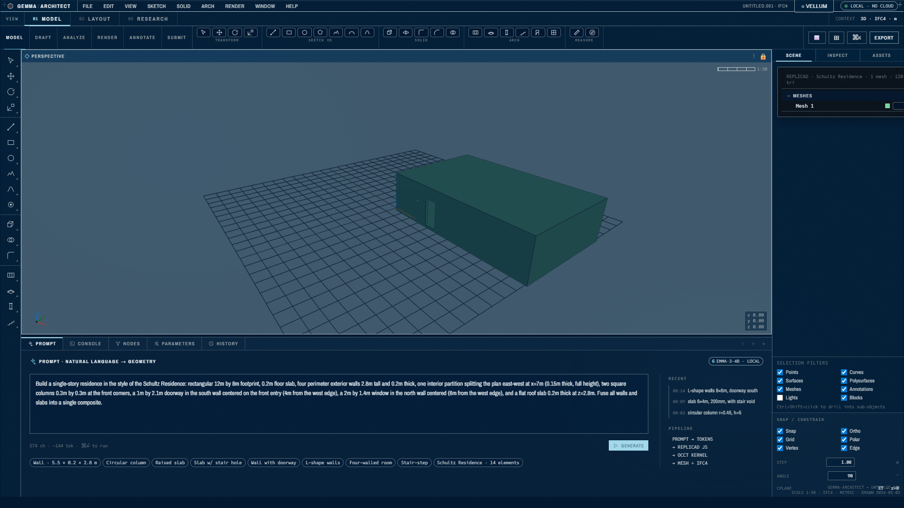

# Gemma-CAD

*Part of the research and design work collected at https://wordingone.github.io/.*

> **At a glance (read this first)**
>
> **Status.** Hackathon prototype, no longer developed. Work continued in [WEB-CAD](https://github.com/wordingone/WEB-CAD), which was forked from this repo on 2026-05-24 ([WEB-CAD `docs/ORIGIN.md`](https://github.com/wordingone/WEB-CAD/blob/master/docs/ORIGIN.md)). The last functional code change here is commit `bd70c1c` (2026-05-25); the 2026-11-04 commit `3f43ee6` was a documentation and tidy-up pass. Built for the Gemma 4 Good Hackathon (Kaggle and Google DeepMind); whether the entry was submitted is **not confirmed** (every item in the checklist in [`submission/README.md`](submission/README.md) is unchecked).
>
> **Who wrote it.** Designed and directed by the repository owner; most of the code was written by AI coding agents (Claude), as the `Co-Authored-By: Claude` lines in the commit history show.
>
> **What the AI feature really does.** Prompts close to one of 60 cached examples are answered from the cache with no model call; only other prompts reach the stock, not fine-tuned, in-browser Gemma 4 model ([`docs/ai-pipeline.md`](docs/ai-pipeline.md)). There is no evaluation of the model's output for novel prompts in this repo.
>
> **What is not verified.** IFC export is checked only by re-opening the file in web-ifc. It has **not** been tested in Revit, ArchiCAD or BlenderBIM (as the note at the top of [`submission/README.md`](submission/README.md) also says). Where the sections below say otherwise, this box takes precedence.
>
> **Try it.** Live page: https://wordingone.github.io/gemma-architect/ (it loaded in headless Chromium on 2026-11-05; the prompt and export flow were not exercised in that check). Run locally with [Bun](https://bun.sh/): `bun install` then `bun run web:dev` (details under [Quick start](#quick-start)).
>
> 
> *Screenshot from the submission folder, captured from the live page in May 2026 ([`submission/screenshots/`](submission/screenshots/)). The building shown is the bundled Schultz Residence sample IFC file loaded in the viewer, not model output. The model badge reads Gemma 3 4B, an earlier setup than the Gemma 4 model described below.*

---

Browser-native experimental CAD from natural-language prompts.
Type a sentence; generate 3D geometry; export an IFC4 file. No server,
no install, no API key — Gemma 4 E4B-it (stock, no fine-tune) + replicad geometry kernel +
web-ifc all run inside a single tab. A bundled 60-row prompt cache covers the canned demos;
the model handles novel prompts on-device.

**Hackathon entry:** Gemma 4 Good Hackathon (Kaggle + Google DeepMind),
deadline 2026-05-18.
**Track:** Equity — 3D parametric design accessibility for non-CAD users.
**License:** CC BY 4.0 (see [`LICENSE`](LICENSE)).

> **Disclaimer:** Gemma-CAD is an experimental tool for exploration and learning. It is **not** a substitute for professional design software, licensed architects, licensed engineers, or any licensed design professional. Output generated by this application (geometry, IFC files, drawings, exports) is **not** verified for structural safety, building code compliance, or constructability. **Do not use output from this application as construction documents or as a basis for construction without independent review by appropriately licensed professionals.** AI-generated content may contain errors. Always consult a licensed architect or engineer for any real-world building project.

---

## What it does

Open the page. Pick a demo (or type your own prompt). Gemma 4 emits a
short replicad JavaScript program. The page executes it in a worker,
meshes the result with OpenCascade, renders with three.js, and offers
an **Export IFC** button that downloads an IFC4 STEP-21 file. The file
re-opens in web-ifc; it has not been tested in Revit, ArchiCAD or
BlenderBIM (see the box at the top).

```
"a wall, 5.5m long, 0.2m thick, 2.8m tall"
                          │
                          ▼
   const e0 = drawRectangle(5.5, 0.2)
                .sketchOnPlane("XY")
                .extrude(2.8);
                          │
              ┌───────────┴───────────┐
              ▼                       ▼
        three.js viewer         wall.ifc download
        (parameter sliders)     (loads in any BIM tool)
```

Nine canned demos ship in the page: walls, columns, raised slabs,
slabs with stair holes, walls with doorways, L-shape walls, four-walled
rooms, stair-step structures, and a 14-element Schultz Residence (the
hero demo, also reachable via the Cmd-K palette). Each has 3-6 sliders
that re-trigger the worker without re-running the model.

Beyond prompt-to-geometry, the page accepts other input modes:
**drag an IFC/STEP/GLB/OBJ/STL file** to load existing 3D models into the viewer;
and **type DSL into the CONSOLE tab** (`wall(...)`,
`slab(...)`, `column(...)`, `cut(...)`) for direct geometric control
without round-tripping through the model.

---

## For judges (60 seconds)

1. Open the [hosted demo](https://wordingone.github.io/gemma-architect/).
2. Press `Cmd-K` (or `Ctrl-K`). Type `schultz`. Press Enter.
3. Watch a 14-element residence emerge in <5 seconds, fully
   IFC4-exportable. Click **Export → IFC4** to download the IFC4 file
   (checked by re-opening it in web-ifc only; see the box at the top).
   The Schultz demo comes from the prompt cache, not a live model call.
4. Click any element. The right sidebar shows IFC class + storey +
   GUID + layer. Ctrl-click two more elements; the panel reports
   `3 elements selected` with a union bounds size — the same
   selection model a working architect uses in Rhino.

That's the equity story in three clicks: a non-CAD user, in a browser,
exports IFC4 geometry without an installer or API key.

---

## AI prompt pipeline

The PROMPT textbox supports two paths:

- **Cache-first (for bundled demos).** A 60-row prompt → JS cache ships with the
  bundle (built from `data/dsl-demo-corpus.jsonl` + Schultz gold + precursor Gemma 3
  LoRA eval outputs archived at `src/train/archive-gemma3/` (scripts only; adapter weights and eval outputs are not tracked)). F1-weighted
  similarity (numeric tokens 2x, stop-words filtered) returns the best
  match in ~50 ms. No GPU, no network call — the path bundled demos use.
- **Live Gemma 4 (default for novel prompts).** Stock `onnx-community/gemma-4-E4B-it-ONNX`
  loads in-browser via Transformers.js v4 (WebGPU). No fine-tune or adapter loaded.
  Novel prompts that miss the cache go directly to the in-browser model.
  (`?gemma_model=e2b` URL param switches to the smaller E2B variant.)

Architecture: [`docs/ai-pipeline.md`](docs/ai-pipeline.md). The
console-DSL terminal that backs the cache's broader-coverage rows is
documented in [`docs/console-dsl.md`](docs/console-dsl.md).

---

## Numbers

| What                                       | Number                            |
| ------------------------------------------ | --------------------------------- |
| Base model                                 | Gemma 4 E4B-it (onnx-community/gemma-4-E4B-it-ONNX) |
| Self-harness demos (no browser)            | 9 / 9 pass                        |
| AI prompt cache rows (DSL + Schultz + archived eval) | 60               |
| DSL corpus rows compiled via `compileDsl()`| 19 / 19 pass                      |

These are what the listed scripts reported when this section was written; they were not re-run on 2026-11-05. Steps: [`submission/repro.md`](submission/repro.md).

---

## Submission artifacts

- [`submission/writeup.md`](submission/writeup.md) — Kaggle post draft.
- [`submission/impact.md`](submission/impact.md) — equity story, who benefits, adoption path.
- [`submission/repro.md`](submission/repro.md) — step-by-step reproduction.
- [`submission/demo-script.md`](submission/demo-script.md) — 3-min demo video voiceover + cuts.
- [`submission/SAMPLES.md`](submission/SAMPLES.md) — bundled IFC sample provenance + per-file licenses (separates the real architect-authored Schultz Residence from synthetic KIT schema-validation fixtures).
- [`submission/screenshots/`](submission/screenshots/) — 9-cell visual sweep from the live deployed page (PROMPT/wall/console/Schultz solid + drafting/EXPORT/Cmd-K/PARAMETERS).

---

## Stack

- **Model:** Gemma 4 E4B-it (`onnx-community/gemma-4-E4B-it-ONNX`), Q4 quantized, loaded in-browser via Transformers.js v4. No fine-tune in the deployed path. (`?gemma_model=e2b` switches to the smaller E2B variant.)
- **Geometry kernel:** [replicad](https://replicad.xyz/) 0.20.0 (LGPL-2.1) on
  [replicad-opencascadejs](https://github.com/sgenoud/replicad) 0.20.2
  (LGPL-2.1 wrapper, with the bundled OpenCascade WASM separately under
  LGPL-2.1 + linking exception).
- **IFC4 parser:** [web-ifc](https://github.com/ThatOpen/engine_web-ifc)
  0.0.77 (MPL-2.0) — the page hand-emits STEP-21 text and round-trips
  it through `IfcAPI.OpenModel` to verify parseability.
- **Viewer:** three.js 0.162.0 (MIT) + OrbitControls.
- **Build:** Vite 8 + TypeScript 5.3 + vite-plugin-wasm + vite-plugin-top-level-await.
- **Runtime:** ES-module web worker for the geometry kernel; main thread
  never blocks. The deployed build is GitHub Pages, which can't serve
  COOP+COEP, so it falls back to single-thread WASM gracefully. The
  multi-thread SharedArrayBuffer path lights up automatically on any
  host that can serve those headers (Vercel, Spaces, self-hosted nginx).

Licences in the chain: CC BY 4.0 (this repo), MIT, MPL-2.0 (web-ifc,
weakly copyleft per file) and LGPL-2.1 with linking exception. Check
each licence's terms before reuse; this README is not legal advice.

---

## Directory layout

| Path | What lives there |
| ---- | ---------------- |
| `web/` | Browser app (Vite + TypeScript). Entry: `web/src/main.ts`. |
| `web/src/worker.ts` | Geometry-kernel web worker (replicad + OpenCascade). |
| `web/src/ifc.ts` + `ifc-build.ts` | IFC4 STEP-21 emit + web-ifc round-trip verify. |
| `web/src/demo-prompts.ts` | The 9 canned demos with parameter slider config (incl. Schultz hero). |
| `web/src/ai-generate.ts` | Cache-first prompt → JS pipeline; falls through to live Gemma 4 on cache miss. |
| `web/src/dsl-eval.ts` | `compileDsl()` — v0 lexicon → JS for the CONSOLE tab. |
| `web/dist/ai-cache.json` | 60-row prompt → JS cache (produced by `bun run web:build` via `scripts/build-ai-cache.ts`). |
| `src/tools/tier1.ts` | The 12-op replicad surface the model is trained against. |
| `src/train/` | Unsloth LoRA training scripts (build dataset, train, eval, publish). |
| `src/serve/serve_lora.py` | OpenAI-compat FastAPI wrapper around the v2 adapter. |
| `src/extract/` | IFC → (NL, replicad) extraction pipeline. |
| `src/generate/` | Synthetic-IFC generator (D2 in 18-day plan). |
| `fixtures/` | Hand-curated training pairs (tier1 + tier1-extra + tier2-curated + mined-extra). |
| `data/dsl-demo-corpus.jsonl` | 19-row DSL corpus that broadens cache coverage. |
| `data/` | Built training/eval JSONL (gitignored — produced by `build_dataset_v2.py`). |
| `outputs/` | LoRA adapter + train stats + eval results (gitignored — produced by training). |
| `scripts/` | Bun scripts: `validate-fixtures.ts`, `web-self-harness.ts`, `generate-v2.ts`, `dev-as-architect.ts`, `probe-conventions.ts`, `build-ai-cache.ts`, `test-ai-match.ts`, `test-ifc-bounds.ts`, `verify-dsl-corpus.ts`. |
| `submission/` | Hackathon submission docs + screenshots. |
| `docs/` | Design docs (`ai-pipeline.md`, `console-dsl.md`, **`tier1-conventions.md`**, tool taxonomy, training-pair format, 18-day plan, retrospectives). |

---

## Quick start

Full reproduction guide: [`submission/repro.md`](submission/repro.md).
TL;DR for the **browser-only** path (no training):

```bash
git clone https://github.com/wordingone/gemma-architect
cd gemma-architect
bun install
bun run web:typecheck       # strict tsc, no emit
bun run web:dev             # http://localhost:5847 — hot reload
# or
bun run web:build           # outputs to web/dist/
bun run web:preview         # http://127.0.0.1:4173 — same build the live demo serves
```

Self-harness (no browser, validates the same data path the worker
takes):

```bash
bun scripts/web-self-harness.ts          # 9/9 canned demos pass
bun scripts/dev-as-architect.ts          # 8/8 hand-written designs (revolve, gables, T-junctions)
bun scripts/probe-conventions.ts         # primitive-by-primitive bounds — run when in doubt
bun scripts/build-ai-cache.ts            # rebuild the 60-row prompt → JS cache
bun scripts/test-ai-match.ts             # F1-similarity smoke test for the matcher
bun scripts/test-ifc-bounds.ts           # IFC viewer column-major matrix regression
bun scripts/verify-dsl-corpus.ts         # 19/19 DSL corpus rows compile + execute
```

The hand-written harness exercises corners of the tool surface the
canned demos don't (revolve, sketchOnPlane("XZ"), drawPolyline N-gons,
nested booleans). What it surfaced about the 12-op convention is in
[`docs/tier1-conventions.md`](docs/tier1-conventions.md) — required
reading for anyone training against this surface.

Training scripts are in `src/train/` (scaffold for a future Gemma 4 retrain; the precursor Gemma 3 LoRA is archived at `src/train/archive-gemma3/` (scripts only; adapter weights and eval outputs are not tracked)).

---

## What ships with this submission

- **GitHub repo** — this repo. CC BY 4.0.
- **Model** — no LoRA adapter ships in this submission. The deployed app runs stock
  `onnx-community/gemma-4-E4B-it-ONNX` in-browser. Training scripts (`src/train/`) are
  scaffolded for a future Gemma 4 retrain; the prior Gemma 3 4B LoRA is archived at
  `src/train/archive-gemma3/` (scripts only; adapter weights and eval outputs are not tracked) and is not loaded by the deployed app.
- **Hosted live demo** — GitHub Pages: https://wordingone.github.io/gemma-architect/
  (single-thread WASM fallback because GH Pages can't serve COOP+COEP;
  multi-thread path lights up on any host that can — Spaces, Vercel,
  self-hosted nginx).
- **3-min demo video** — script in [`submission/demo-script.md`](submission/demo-script.md);
  video URL filled in at submission time.

---

## Limitations

- **Tier 1 vocabulary only** — schematic-design primitives (walls,
  slabs, columns, footings, basic openings via `cut`, L-shape and
  U-shape footprints). Construction-document detailing is out of scope.
- **English only.** Corpus expansion to other languages is a dataset
  job, not a model-architecture job.
- **Not a structural validator.** The model produces geometry that
  *could* be a wall; it does not check that the wall would stand. That
  belongs to the engineer who picks up the IFC export.
- **Semantic placement gaps.** The held-out eval of the earlier Gemma 3 LoRA (outputs not tracked in this repo) scored `runtime_pass`
  (the JS executes and produces a Solid). Some emitted sequences place
  components in geometrically-imprecise positions (e.g., the
  four-walled room's bounding box is slightly wider than the spec calls
  for). Tier 2 dataset work + per-row positional eval is the obvious
  next step.

Full discussion in [`submission/writeup.md`](submission/writeup.md#limitations).

---

## Contributing

This repo is no longer developed; active work is in
[WEB-CAD](https://github.com/wordingone/WEB-CAD). The 18-day hackathon
plan at [`docs/plan-18-day.md`](docs/plan-18-day.md) and the roadmap in
[`submission/impact.md`](submission/impact.md#adoption-path) are kept as historical records.

---

## Author

[wordingone](https://github.com/wordingone)
